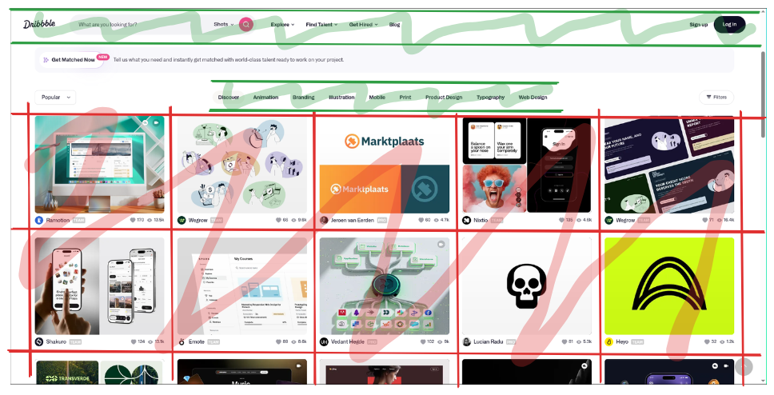

# Tailwind CSS

> "There are only two hard things in Computer Science: cache invalidation and naming things."

\-- Phil Karlton, early developer of Netscape Navigator, the first commercial web browser

## CSS Introduction

The web is styled using CSS (Cascading Style Sheets). Properties are applied to HTML elements to change their color, size, padding, and layout. The traditional way to of writing CSS is to create separate CSS files defining classes and then applying those classes to HTML elements.

```css titel="styles.css"
.heading {
  font-weight: bold;
  color: blue;
  font-size: xx-large;
}
```

```tsx title="App.tsx"
// Import the CSS file in the component
import "./App.css";

export default function App() {
  return (
    <div>
      {/* Use the css property*/}
      <h1 className="heading">Dice Roller</h1>

      {/* Rest of app omitted*/}
    </div>
  );
}
```

However, this approach leads to several problems:

1. **Naming (see quote)**: Coming up with accurate and descriptive class names can be difficult. There are no standard naming conventions between projects.
2. **Unused CSS**: As the project grows, CSS classes which are no longer used will still be bundled with the application and sent to the client.
3. **Cumbersome development workflow**: Tabbing back and forth between HTML and CSS files causes unnecessary context switching.

Most importantly, the traditional approach is not oriented around the fundamental mental model used in React Development: components. Components are designed to be self contained reusable units of code. We don't really care about reusing CSS classes, we care about reusing the _all_ of the markup, styling, and logic of a component.

## Tailwind CSS

Tailwind CSS solves all of these problems. All it is is a set of pre-defined utility classes, which can be applied directly to HTML elements. These utility classes closely mirror the underlying CSS properties, meaning that it you can start using it effortlessly if you are already familiar with CSS. It also means you can just start using Tailwind without having ever written any CSS before, and you will learn the underlying CSS properties as you learn Tailwind.

```tsx title="App.tsx"
export default function App() {
  return (
    <div>
      {/* Use the css property*/}
      <h1 className="font-bold text-blue-500 text-2xl">Dice Roller</h1>

      {/* Rest of app omitted*/}
    </div>
  );
}
```

Tailwind's default class names are consistent between projects, making them easy to remember and use (solving the naming problem). Writing class names directly in the markup turns our components into truly self contained units which do not require looking at multiple files to understand (solving the context switching problem). Finally, Tailwind only includes class names that are actually used in the final build, meaning that unused CSS is not sent to the client (solving the unused CSS problem). As a result of these benefits, Tailwind has become the default way of writing CSS on the web. 


## Styling Individual Components

### Text

### Backgrounds

###

## Layouts

CSS (and Tailwind by extension), have two main ways of laying out content: flexbox, and grid. Flexbox is used for laying out content in one dimension, while grids layout content in two dimensions. 

Most layouts are actually one dimensional. Even things like data tables, from a CSS perspective, are one dimensional. If you can draw a # symbol over some content on a web page and have the *same* type of content in each square, then a grid layout is likely being used.

For an example of each, look at the [dribble](https://dribbble.com/) homepage. The horizontal nav bars (highlighted in green), are one dimensional, and the grid of images is two dimensional.



### Flexbox

<!-- Row vs col -->
<!--  -->

### Grid

## Responsive Design
